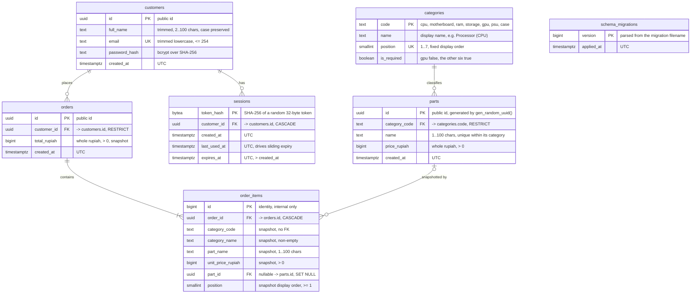

# pc-builder — Data design (compzy)

PostgreSQL 16 schema for the PC Builder feature. Produced through the
`nexcraft:schema-designer` gate (ERD → advisory normalization review → batched
migration plan, all recorded in this document) and the house database design
standards. The gate's working notes are deliberately not committed: this file
and `compzy/ERD.md` are the stage's deliverables, and `/go-dev` reads them. **No DDL is written here**: `/go-dev` writes
the migration files in the batch order below.

Six domain tables plus the runner's bookkeeping table (seven tables in all):

- `categories` — the seven fixed part categories, in fixed display order.
- `parts` — the 21 seeded parts with their rupiah prices.
- `customers` — self-service accounts, one per email address.
- `sessions` — opaque, hashed sign-in sessions.
- `orders` — one submitted order per checkout, with its total.
- `order_items` — an immutable snapshot of what each order contained.
- `schema_migrations` — infrastructure: which migration files have run.

There is **no `builds` table**. A build belongs to a browser, not to an
account (a visitor has no identity), and the spec forbids saved or named
builds. The frontend keeps it; the API only validates a submitted set of part
ids.

## ERD

`order_items.category_code` deliberately has no FK: it is a snapshot value, so
an order still renders after a category is renamed or removed.

## Tables

### `categories`

| Column | Type | Null | Constraint / note |
|---|---|---|---|
| `code` | `text` | no | PK; CHECK in the seven codes; the domain enum |
| `name` | `text` | no | Display name shown in the picker and the review |
| `position` | `smallint` | no | UNIQUE; CHECK `>= 1`; fixed display order 1..7 |
| `is_required` | `boolean` | no | `gpu` false; the other six true (REQ-008) |

Seven seeded rows, never mutated in v1, so no timestamps.

### `parts`

| Column | Type | Null | Constraint / note |
|---|---|---|---|
| `id` | `uuid` | no | PK, default `gen_random_uuid()`; the public id |
| `category_code` | `text` | no | FK → `categories(code)` ON DELETE RESTRICT |
| `name` | `text` | no | CHECK `char_length(name) BETWEEN 1 AND 100` (REQ-039) |
| `price_rupiah` | `bigint` | no | CHECK `> 0`; whole rupiah only |
| `created_at` | `timestamptz` | no | default `now()` |

UNIQUE `(category_code, name)` (REQ-039). Hard delete is allowed: order items
keep their own snapshot and `order_items.part_id` becomes NULL.

### `customers`

| Column | Type | Null | Constraint / note |
|---|---|---|---|
| `id` | `uuid` | no | PK, default `gen_random_uuid()`; the public id |
| `full_name` | `text` | no | Stored `btrim`ed; CHECK trimmed length 2..100; internal spacing and case preserved (REQ-034) |
| `email` | `text` | no | Stored trimmed and lower-cased; UNIQUE; CHECK `email = lower(email)`, `email = btrim(email)`, length ≤ 254 (REQ-032, REQ-033) |
| `password_hash` | `text` | no | CHECK non-empty; bcrypt (cost 12) over a SHA-256 of the password |
| `created_at` | `timestamptz` | no | default `now()` |

No password-reset, verification or profile columns: all are non-goals.

### `sessions`

| Column | Type | Null | Constraint / note |
|---|---|---|---|
| `token_hash` | `bytea` | no | PK; CHECK `octet_length(token_hash) = 32`; SHA-256 of the raw token |
| `customer_id` | `uuid` | no | FK → `customers(id)` ON DELETE CASCADE |
| `created_at` | `timestamptz` | no | default `now()` |
| `last_used_at` | `timestamptz` | no | default `now()` |
| `expires_at` | `timestamptz` | no | CHECK `expires_at > created_at` |

The raw token exists only in the cookie. Expired rows are hard-deleted
opportunistically by a small cleanup query on the sign-in path (no scheduler at
this scale).

### `orders`

| Column | Type | Null | Constraint / note |
|---|---|---|---|
| `id` | `uuid` | no | PK, default `gen_random_uuid()`; the public id |
| `customer_id` | `uuid` | no | FK → `customers(id)` ON DELETE RESTRICT |
| `total_rupiah` | `bigint` | no | CHECK `> 0`; the total recomputed and recorded at confirmation (REQ-029, REQ-040) |
| `created_at` | `timestamptz` | no | default `now()` |

No `status`: v1 has one state, "submitted", and inventing a workflow column
would be vocabulary the business never asked for. No idempotency key in v1
(see "Risks carried into implementation").

### `order_items`

| Column | Type | Null | Constraint / note |
|---|---|---|---|
| `id` | `bigint` | no | `GENERATED ALWAYS AS IDENTITY` PK; internal only |
| `order_id` | `uuid` | no | FK → `orders(id)` ON DELETE CASCADE |
| `category_code` | `text` | no | Snapshot; no FK |
| `category_name` | `text` | no | Snapshot; CHECK non-empty |
| `part_name` | `text` | no | Snapshot; CHECK length 1..100 |
| `unit_price_rupiah` | `bigint` | no | Snapshot; CHECK `> 0` |
| `part_id` | `uuid` | yes | FK → `parts(id)` ON DELETE SET NULL; a support link, never the source of truth |
| `position` | `smallint` | no | Snapshot display order; CHECK `>= 1` |

UNIQUE `(order_id, category_code)` — at most one part per category per order
(REQ-037). No timestamps: the parent order's `created_at` covers the rows,
inserted in the same transaction.

### `schema_migrations`

| Column | Type | Null | Constraint / note |
|---|---|---|---|
| `version` | `bigint` | no | PK, parsed from the filename (`0001` → `1`) |
| `applied_at` | `timestamptz` | no | default `now()` |

Created by the runner with `IF NOT EXISTS` before it reads applied versions.

## Keys, constraints and indexes

| Name | Definition | Serves |
|---|---|---|
| `categories_pkey` | PK `(code)` | Row identity; FK target for `parts.category_code` |
| `categories_code_check` | `code IN (…)` over the seven codes | REQ-002 fixed set |
| `categories_position_key` | UNIQUE `(position)` | Deterministic display order; catches seed mistakes |
| `categories_position_check` | `position >= 1` | Non-negative ordering |
| `parts_pkey` | PK `(id)` | Row identity; FK target for `order_items.part_id` |
| `parts_category_code_name_key` | UNIQUE `(category_code, name)` | REQ-039; also serves the catalogue read and the FK child index (leftmost column) |
| `parts_category_code_fkey` | FK → `categories(code)` RESTRICT | No part without its category; a category with parts cannot be deleted |
| `parts_name_check` | `char_length(name) BETWEEN 1 AND 100` | REQ-039 |
| `parts_price_rupiah_check` | `price_rupiah > 0` | REQ-039 |
| `customers_pkey` | PK `(id)` | Row identity; FK target for sessions and orders |
| `customers_email_key` | UNIQUE `(email)` | Sign-in lookup and REQ-033 duplicate detection |
| `customers_email_lower_check` | `email = lower(email)` AND `email = btrim(email)` | Case-insensitive identity by construction |
| `customers_email_length_check` | `char_length(email) <= 254` | REQ-032 |
| `customers_full_name_check` | `char_length(btrim(full_name)) BETWEEN 2 AND 100` | REQ-034 |
| `sessions_pkey` | PK `(token_hash)` | Every authenticated request and sign-out |
| `sessions_token_hash_check` | `octet_length(token_hash) = 32` | SHA-256 only; no raw token stored |
| `sessions_customer_id_fkey` | FK → `customers(id)` CASCADE | Removing an account removes its sessions |
| `sessions_customer_id_idx` | `(customer_id)` | FK/cascade support |
| `sessions_expires_at_idx` | `(expires_at)` | Expired-session cleanup |
| `sessions_expires_at_check` | `expires_at > created_at` | No already-expired session at insert |
| `orders_pkey` | PK `(id)` | Confirmation read by public id |
| `orders_customer_id_fkey` | FK → `customers(id)` RESTRICT | An order is never cascade-deleted with an account |
| `orders_customer_id_idx` | `(customer_id)` | FK support (no v1 query needs it; every FK is indexed by rule) |
| `orders_total_rupiah_check` | `total_rupiah > 0` | A real build always costs more than zero |
| `order_items_pkey` | PK `(id)` | Row identity (internal) |
| `order_items_order_id_category_code_key` | UNIQUE `(order_id, category_code)` | One part per category; leftmost `order_id` serves the order→items read and the FK index |
| `order_items_order_id_fkey` | FK → `orders(id)` CASCADE | An item has no meaning without its order |
| `order_items_part_id_fkey` | FK → `parts(id)` SET NULL | A deleted part never deletes or blocks a historical order |
| `order_items_part_id_idx` | `(part_id)` | FK support for the SET NULL action |
| `order_items_unit_price_rupiah_check` | `> 0` | Snapshot of a valid part price |
| `order_items_position_check` | `position >= 1` | Snapshot display order |
| `schema_migrations_pkey` | PK `(version)` | Runner's applied-version check |

**Deliberately not indexed:** `parts.price_rupiah`, `parts.created_at`,
`orders.created_at`, `order_items.category_code`, `categories.is_required`,
`sessions.last_used_at`. No v1 query sorts or filters on them, the catalogue is
21 rows and orders are a few thousand a year. No separate
`parts_category_code_idx` or `order_items_order_id_idx` either — the leftmost
column of each unique constraint already covers those paths.

## Normalization decisions

All deliberate; none is an unreviewed redundancy.

- **`order_items` is an immutable snapshot** (`category_code`,
  `category_name`, `part_name`, `unit_price_rupiah`, `position`). Joining to
  `parts`/`categories` at read time would show today's prices on a historical
  order, which REQ-041 forbids. `part_id` stays as a nullable, best-effort
  link for support.
- **`orders.total_rupiah` duplicates the sum of its items.** It is computed
  and inserted in the same transaction as the items, so it is one source of
  truth written once; a trigger to derive it is not worth the machinery at
  this scale.
- **`order_items.position` duplicates `categories.position`.** It freezes the
  confirmation's order even if the category order changes later.
- **`order_items.category_code` has no FK** to `categories.code`, so a
  historical order survives a category change. The value is copied from an
  FK-validated `parts` row.
- **No `builds` table.** The build is browser state; the spec has no saved
  builds and a visitor has no identity to key them on.
- **No soft delete.** Hard delete plus snapshot; no delete capability exists
  for accounts or orders in v1.

## Deviations from the house schema standards

Recorded rather than silently taken:

- **Surrogate keys.** The standard's default is one surrogate `id` plus a
  separate public `uuid_key` on API-addressed tables. Here the public UUID is
  the primary key on `parts`, `customers` and `orders` (it is opaque and
  stable, so the second column buys nothing), and `categories.code` and
  `sessions.token_hash` are natural-key PKs (7 immutable reference rows; the
  hash is the only address and is never exposed). `order_items` keeps a bigint
  identity PK because nothing addresses it externally.
- **Audit columns.** Only `created_at` is present where rows are created.
  `updated_at` was dropped from `parts` and `customers` because neither has a
  writer in v1; `created_by`/`updated_by`/`deleted_by` are omitted because
  there is no admin actor and no delete path, so they would be permanently
  NULL. Add them with the first admin or edit feature. Timestamps are
  `timestamptz` in UTC.
- **No `status` column anywhere**, so the soft-delete-versus-business-status
  rule cannot be violated. When a business workflow appears (for example order
  cancellation), it gets its own `status` column, separate from any deletion
  columns.

## Access control

Who may see or manage what, at the data layer:

| Data | Read | Write |
|---|---|---|
| `categories`, `parts` | Any caller via `GET /api/v1/catalogue` (public) | Nobody in v1 — seed data only; a later price/part change is a forward migration |
| `customers` | The customer themself (`GET /auth/me`); the API never lists customers | The customer, at registration only |
| `sessions` | The caller themself, by presenting the raw token | Created at sign-in/registration, deleted at sign-out |
| `orders`, `order_items` | Only the customer who placed the order, filtered by `customer_id` in the SQL and returning `404` for anything else | Created only by that customer at checkout |

No endpoint accepts a customer id from the client, and no row is reachable by
guessing: every public id is a random UUID, and an order read that does not
match the session's customer is indistinguishable from a missing order.

## Migration batches

Forward-only: embedded `.sql` files applied in ascending filename order at
startup, one transaction per file, each recorded in `schema_migrations`. There
are no down scripts in v1 — this is a greenfield service, and rollback is
restoring the pre-deployment backup.

- **Batch 0 — runner (not a migration).** On startup take a PostgreSQL
  advisory lock (`pg_advisory_lock`), create `schema_migrations` with
  `IF NOT EXISTS`, read applied versions, apply pending files ascending, then
  release the lock. A second startup reports zero pending and changes nothing.
- **Batch 1 — `0001_categories_customers.sql`.** Create and seed `categories`
  (7 exact rows), create `customers` with its unique email and checks.
- **Batch 2 — `0002_parts.sql`.** Create and seed `parts` (21 exact rows), FK
  to `categories` with RESTRICT, unique name per category, price and name
  checks.
- **Batch 3 — `0003_sessions_orders.sql`.** Create `sessions` (hash PK,
  32-byte check, indexes on customer and expiry) and `orders` (FK, total check,
  customer index).
- **Batch 4 — `0004_order_items.sql`.** Create `order_items` (identity PK,
  order FK CASCADE, snapshot columns, nullable part FK SET NULL, unique
  category per order, part index).

Ordering rationale: categories before parts, customers before sessions and
orders, orders and parts before order_items. Each batch leaves the database
valid and queryable on its own.

### Seed data — categories

| # | `code` | `name` | `position` | `is_required` |
|---|---|---|---|---|
| 1 | `cpu` | Processor (CPU) | 1 | true |
| 2 | `motherboard` | Motherboard | 2 | true |
| 3 | `ram` | RAM | 3 | true |
| 4 | `storage` | Storage (SSD) | 4 | true |
| 5 | `gpu` | Graphics Card | 5 | false |
| 6 | `psu` | Power Supply | 6 | true |
| 7 | `case` | PC Case | 7 | true |

### Seed data — 21 parts

Exact names and prices from `spec.md`'s Sample Parts Catalogue.

| `category_code` | `name` | `price_rupiah` |
|---|---|---|
| `cpu` | Intel Core i3-12100F | 1350000 |
| `cpu` | Intel Core i5-12400F | 2150000 |
| `cpu` | AMD Ryzen 5 5600 | 1850000 |
| `motherboard` | ASRock H610M-HDV | 1050000 |
| `motherboard` | MSI B660M-A PRO | 1750000 |
| `motherboard` | ASUS TUF B550M-PLUS | 2100000 |
| `ram` | Kingston Fury 8GB DDR4-3200 | 350000 |
| `ram` | Kingston Fury 16GB DDR4-3200 | 620000 |
| `ram` | Corsair Vengeance 32GB DDR4-3600 | 1250000 |
| `storage` | Kingston NV2 500GB NVMe | 480000 |
| `storage` | Samsung 980 1TB NVMe | 950000 |
| `storage` | WD Black SN770 2TB NVMe | 1850000 |
| `gpu` | ASUS Dual RTX 3050 8GB | 3100000 |
| `gpu` | Sapphire Pulse RX 6600 8GB | 3450000 |
| `gpu` | Gigabyte RTX 4060 8GB | 4250000 |
| `psu` | Corsair CV550 550W | 650000 |
| `psu` | Cooler Master MWE 650 Bronze | 850000 |
| `psu` | Seasonic Focus GX-750 750W | 1450000 |
| `case` | Cube Gaming Nerva M-ATX | 350000 |
| `case` | Aerocool Hive-G | 550000 |
| `case` | NZXT H5 Flow | 1450000 |

The seed inserts are idempotent (`ON CONFLICT DO NOTHING` on the natural keys)
so a manual re-run is a no-op; the runner also records each file once. A later
price change is a new forward migration, never a silent upsert. Sanity checks:
the spec's mid-range build sums to Rp 12.020.000, and the most expensive part in
every category sums to Rp 14.500.000.

## Operational notes

- **Expired sessions** are deleted opportunistically on the sign-in path and
  by a `DELETE … WHERE expires_at < now()` run at most once an hour in the
  background goroutine started with the server — no scheduler, no cron.
- **Sliding expiry** extends `expires_at` and `last_used_at` only when
  `last_used_at` is older than one hour, so an active customer is never signed
  out (REQ-011) without a database write on every request.
- **Email normalisation** is both a storage rule (`customers_email_lower_check`)
  and an application rule: registration and sign-in trim and lower-case the
  input before storing or looking it up.

## Risks carried into implementation

- **R-1 — double submit.** No idempotency key in v1; the confirm control is
  disabled while a request is in flight and the client never auto-retries.
  Adding `orders.idempotency_key` with UNIQUE `(customer_id, idempotency_key)`
  is the upgrade if duplicates ever become possible.
- **R-4 — a hard-deleted part loses its catalogue link.** The name/price
  snapshot is enough for v1; if support needs the link, switch the FK to
  RESTRICT or add a `part_sku` snapshot.
- **R-5 — mixed-case sign-in.** The database stores lower-case emails; the Go
  sign-in path must lower-case and trim the input too, or a mixed-case sign-in
  will miss.
- **R-6 — startup concurrency.** Two instances starting together could both
  apply migrations; the advisory lock in Batch 0 is what prevents it.
- **R-8 — total/items divergence.** They are written in one transaction from
  one set of validated prices; the service asserts `total == sum(items)`
  before commit.
